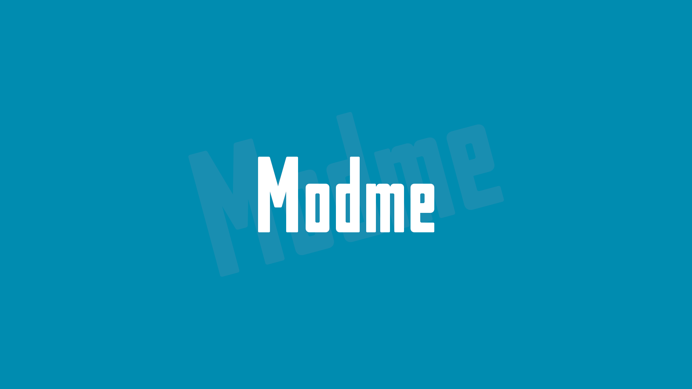

<p align="center">
  <b>Add and remove mods for your favorite games, the fast and simple way</b>
</p>

Modme is an [Ultimate ASI Loader](https://github.com/ThirteenAG/Ultimate-ASI-Loader) plugin. Every mod lives in its own folder, and the game sees the mod's files in place of the originals. Delete the folder and the mod is gone.

## Supported games
- Bully: Scholarship Edition
- Worms Ultimate Mayhem

Modme is intended for other 32-bit games too. Compatibility depends on the file APIs and archive formats a game uses; loading through [Ultimate ASI Loader](https://github.com/ThirteenAG/Ultimate-ASI-Loader) alone does not guarantee compatibility. Current testing focuses on Bully: Scholarship Edition.

## Installation
1. Install [Ultimate ASI Loader](https://github.com/ThirteenAG/Ultimate-ASI-Loader/releases).
2. Put `Modme.asi` in `Update` (or any UAL plugin folder) with a `Modme` folder next to it.

## Mods
Each folder in `Modme` is a mod whose files mirror the game folder:

```
Modme\HD HUD\TXD\fe1.txd               -> TXD\fe1.txd
Modme\HD HUD\Stream\World.img          -> Stream\World.img
Modme\Skins\Stream\World.img\Bully.nft -> Bully.nft inside Stream\World.img
Modme\SilentPatch\SilentPatchBully.asi -> loaded as an ASI plugin
```

- A folder named like an `.img` archive holds single entries for it, so mods that change different files in the same archive work together. Entries that don't fit in place are added at the end of the archive, in memory only. An empty file removes the entry with its name.
- If two mods ship the same file, the one with the higher priority wins; with equal priorities, the first one alphabetically wins.
- Files inside mods are never written to; the game writes to its own copies.
- Files the game expects outside its folder (e.g. `C:\Textures\wall.dds`) can ship as `Modme\Some Mod\Textures\wall.dds` and are used only if the real file is missing.

## Configuration
`Modme.yaml` next to `Modme.asi` is created at startup, and new mod folders and missing settings are added to it with their defaults (on reload too). Your values are kept; comments are lost when something is added:

```yaml
hot_reload: true
modifications:
  HD HUD:
    enable: true
    priority: 60
  Something:
    enable: false
```

A disabled mod gives no files and loads no plugins.

With `hot_reload` on (the default), changes in the mods folder and in `Modme.yaml` apply while the game runs: files the game opens from then on come from the new setup. What the game already loaded stays until it loads it again, and plugins and entries of archives the game already opened change after a restart.

If the configuration is missing, empty or invalid during hot reload, the current setup stays active. Fixing the file allows the next reload to apply it. On startup, a missing configuration is generated; unreadable or broken configuration falls back to defaults. Automatic configuration updates use a temporary file before replacing the original.

`Modme.log` next to `Modme.asi` lists loaded mods, conflicts, plugins and replaced files.

## Limitations
- Archive entry names must be ASCII and up to 24 characters.
- Virtual archive reads support `ReadFile`, explicit events and I/O completion ports associated through `CreateIoCompletionPort`, including completion suppression flags. Replacement reads complete synchronously; there is no background read queue.
- Memory-mapped archive access, `ReadFileEx` completion callbacks and thread pool I/O notifications are not virtualized.

## Building
Visual Studio 2026 with the C++ workload:

```
git clone --recursive https://github.com/sndth/Modme.git
cd Modme
premake5.exe vs2026
```

Open `build\Modme.slnx`, build and run `TestModme`. The tests load `Modme.asi` into a fake game folder and check file redirection, conflicts, plugin loading and the log.

To also check a real archive and a folder of replacement entries, set `MODME_TEST_ARCHIVE` to the original `.img` path and `MODME_TEST_ENTRIES` to the folder containing the replacement files before running `TestModme`. Its `.dir` must sit beside the original archive. The test compares every retained entry with its original or replacement bytes and checks replacement reads through IOCP. It creates a hard link to the source IMG in the test folder, so the archive and test output must be on the same volume. The source archive is only read. This verifies file delivery, not whether the game accepts the mod's models and textures.

## License
Modme is released under the [MIT](LICENSE) license. It uses [MinHook](https://github.com/TsudaKageyu/minhook) (BSD 2-Clause), [fkYAML](https://github.com/fktn-k/fkYAML) (MIT), [doctest](https://github.com/doctest/doctest) (MIT) for tests and ships [Premake](https://github.com/premake/premake-core) ([BSD 3-Clause](LICENSE-Premake)) for building.
